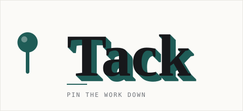
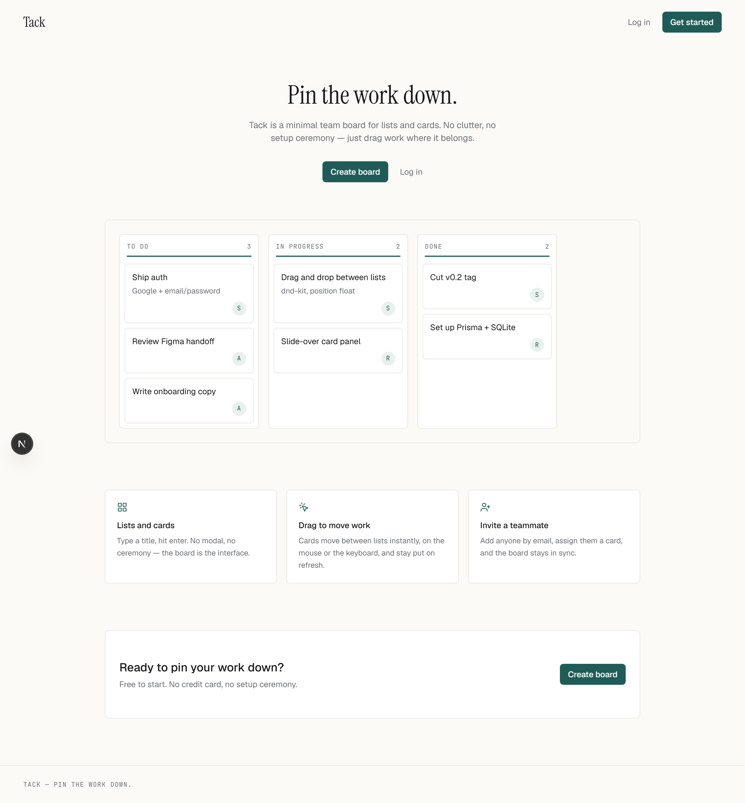
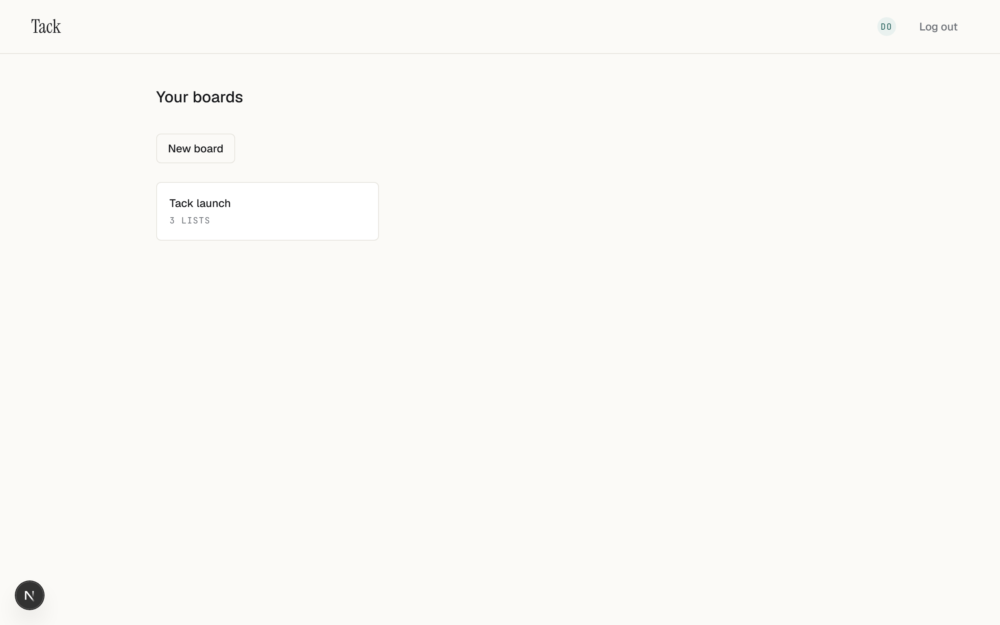

<div align="center">



<p></p>

**A minimal team board. Lists, cards, drag, done.**

[](https://nextjs.org)
[](https://www.typescriptlang.org)
[](https://tailwindcss.com)
[](https://www.prisma.io)
[](https://authjs.dev)
[](https://www.framer.com/motion/)

</div>

---

## What is this

Tack is a small, opinionated project board: boards → lists → cards, dragged between lists with the mouse or keyboard. It's built to look deliberate with almost no UI — one accent color, hairline borders, a mono-label layer for structure, and a single signature detail (the "tack rail," a pine underline that fills a list header only when it holds cards).

No REST layer, no client-side data-fetching library. Every mutation is a **Server Action**, backed by Prisma against Postgres.

## Screenshots



<table>
<tr>
<td width="50%"><br/><sub>Login — Google + credentials</sub></td>
<td width="50%"><br/><sub>Boards grid</sub></td>
</tr>
<tr>
<td width="50%"><br/><sub>Board — lists, cards, drag &amp; drop</sub></td>
<td width="50%"><br/><sub>Board at 390px — horizontal scroll</sub></td>
</tr>
</table>

*(All captured against a live local build at 2x scale — nothing staged.)*

## Features

- **Google + email/password auth** via Auth.js v5, sessions as JWT.
- **Boards, lists, cards** with inline "type and hit Enter" creation.
- **Drag and drop** across and within lists (`dnd-kit`), with optimistic UI — the card moves instantly and only snaps back if the server rejects it.
- **Card slide-over**: description, assignee, delete — autosaves on blur, slides in/out instead of popping.
- **Invite by email** to add a teammate to a board.
- **Motion throughout**, not just the landing page: page-to-page transitions, tap/hover feedback on every button, an animated invite popover and card panel — all disabled automatically under `prefers-reduced-motion`, and deliberately kept off the board's draggable cards so it never fights `dnd-kit`'s own transform.
- **Breadcrumb navigation** (`Tack / Boards / <board title>`) on the board page — no dead end that only the browser's back button can escape.
- **Live sync** — other members' changes show up without a manual refresh (see below).
- Keyboard-navigable, focus-visible everywhere, works down to a 375px viewport.

## Tech stack

| Layer | Choice |
|---|---|
| Framework | Next.js 16, App Router, TypeScript (strict, no `any`) |
| Styling | Tailwind CSS v4, design tokens in `globals.css` |
| Motion | Framer Motion, app-wide — page transitions, button feedback, panel/popover animation |
| Auth | Auth.js v5 — Google OAuth + Credentials |
| Database | Prisma 5 + PostgreSQL |
| Drag & drop | `@dnd-kit/core` + `@dnd-kit/sortable` |
| Icons | `lucide-react` |
| Mutations | Server Actions exclusively — no REST endpoints, no React Query |

## Getting started

```bash
npm install
npm run dev
```

Open [http://localhost:3000](http://localhost:3000). A demo account is already seeded:

```
email:    demo@tack.app
password: password123
```

Re-seed any time with `npm run seed`.

### Google sign-in (optional)

Credentials login works with zero setup. To also enable "Continue with Google":

1. Create an OAuth client in the [Google Cloud console](https://console.cloud.google.com/apis/credentials).
2. Add authorized redirect URI: `http://localhost:3000/api/auth/callback/google`.
3. Set `AUTH_GOOGLE_ID` / `AUTH_GOOGLE_SECRET` in `.env.local` (see `.env.example`).

### Database

Postgres (works locally and in production against the same connection — no local DB engine to install). Get a free instance from [Neon](https://neon.tech) or [Supabase](https://supabase.com), or provision Vercel Postgres from your Vercel project's Storage tab.

```bash
# DATABASE_URL in .env.local, then:
npx prisma db push   # sync schema.prisma -> your database
npm run seed          # seed a demo board
```

Schema in `prisma/schema.prisma`.

## Deployment (Vercel)

1. **Database first.** Create a Postgres instance (Neon/Supabase free tier, or Vercel Postgres) and copy its connection string.
2. Push the schema against it: set `DATABASE_URL` in `.env.local` to that string, run `npx prisma db push`, then `npm run seed` if you want the demo board.
3. `vercel login`, then `vercel link` from the project root.
4. Set environment variables on the Vercel project (`vercel env add <NAME> production`, or via the dashboard): `AUTH_SECRET`, `AUTH_GOOGLE_ID`, `AUTH_GOOGLE_SECRET`, `DATABASE_URL`.
5. In the [Google Cloud console](https://console.cloud.google.com/apis/credentials), add your production callback to the OAuth client's authorized redirect URIs: `https://<your-domain>/api/auth/callback/google`.
6. `vercel --prod`.

`trustHost: true` in `src/auth.ts` means Auth.js trusts whatever `Host` header Vercel forwards — no `AUTH_URL` pinning needed.

## Project structure

```
src/
├── app/
│   ├── page.tsx              # landing page (server) + motion components
│   ├── login/  register/     # auth pages
│   ├── boards/                # board grid
│   │   └── [id]/              # single board (lists, cards, dnd)
│   └── api/auth/[...nextauth]/
├── auth.ts                    # Auth.js config
├── proxy.ts                   # route guard for /boards/:path*
├── components/
│   ├── board/                 # board view, list column, card, slide-over
│   ├── landing/                # hero, board preview, header (Framer Motion)
│   ├── page-transition.tsx     # AnimatePresence wrapper, mounted in the root layout
│   └── ...                    # button, input, avatar, logo primitives (motion-enabled)
└── lib/
    ├── actions/                # every mutation — boards, lists, cards, members, auth
    ├── prisma.ts               # PrismaClient singleton
    └── utils.ts
prisma/
├── schema.prisma
└── seed.ts
```

## Scripts

| Command | Does |
|---|---|
| `npm run dev` | Start the dev server (Turbopack) |
| `npm run build` | Production build — type-checked, must pass clean |
| `npm run start` | Serve the production build |
| `npm run lint` | ESLint |
| `npm run seed` | Seed a demo board |
| `npm run screenshot` | Re-capture the README screenshots against a running build (needs `npx playwright install chromium` once) |

## Design tokens — "bone & pine"

| Token | Value | Used for |
|---|---|---|
| `--color-bone` | `#FBFAF7` | App background |
| `--color-surface` | `#FFFFFF` | Cards, panels |
| `--color-ink` | `#17181B` | Primary text |
| `--color-muted` | `#6E7278` | Secondary text, meta |
| `--color-rule` | `#E7E5DF` | Hairlines — the primary way things separate |
| `--color-pine` | `#1F5C57` | The one accent: buttons, focus rings, tack rail |
| `--color-tint` | `#E9F1EF` | Hover / active states |

One accent color, no gradients, no shadow at rest — the only shadow in the app is on a card mid-drag.

## Performance notes

- `lucide-react` and `framer-motion` are tree-shaken per-import via `experimental.optimizePackageImports` in `next.config.ts`.
- Every board mutation resolves membership in a **single** joined Prisma query instead of two round trips.
- `useOptimistic` covers every board mutation (add/move/edit/delete), not just drag — the UI updates instantly and only reconciles from the server on failure.
- Framer Motion runs app-wide (page transitions, buttons, panels), but is deliberately kept off the board's draggable cards — the two would fight over the same transform. Drag interactions stay on `dnd-kit`'s GPU-friendly transforms alone.
- `DndContext` is given a stable `id` (`dnd-${boardId}`) — `dnd-kit` otherwise auto-generates its internal accessibility IDs, which differ between server and client render and throw a real hydration mismatch in dev.
- First-visit-per-route compiles in `next dev` are inherent to Turbopack's on-demand dev compilation — for a true read on production speed, use `npm run build && npm run start`.

## What's out of scope

- List reordering / deletion — lists are append-only; only cards drag between them.
- Email verification and password reset.

## Live sync

Other members' changes show up without a manual refresh — the board polls every 3s via `router.refresh()` and re-renders with fresh server data. No websockets, no third-party pub/sub account to wire up. It's suspended automatically:

- while the browser tab is in the background (`document.visibilityState`),
- mid-drag, so an incoming refresh can never yank a card out from under `dnd-kit`,
- while any of your own mutations are still in flight (`useTransition`'s pending state).

This trades true push-based instancy for zero added infrastructure — good enough at this scale; a Postgres `LISTEN/NOTIFY` bridge or a hosted pub/sub (Pusher, Ably, Supabase Realtime) would get changes down to sub-second if that's ever needed.
