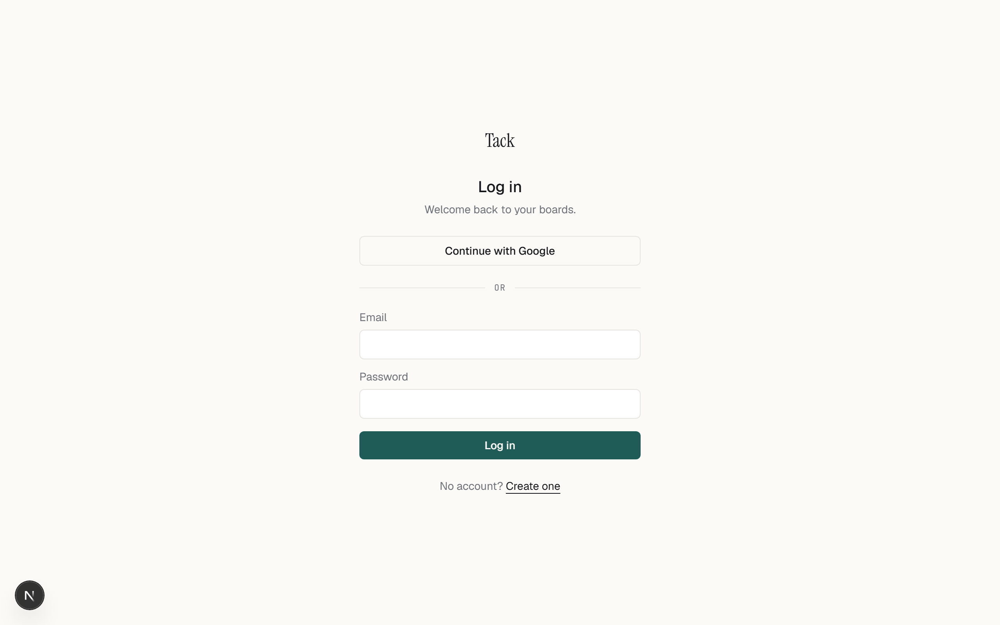
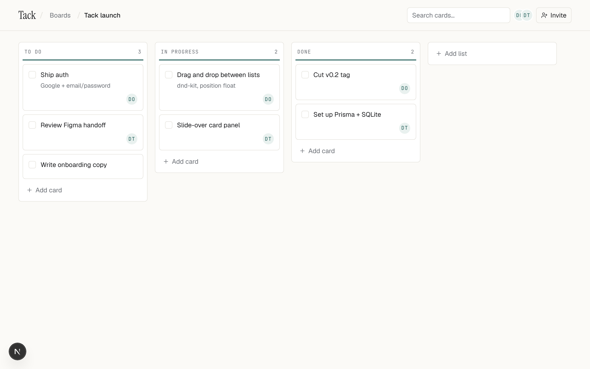
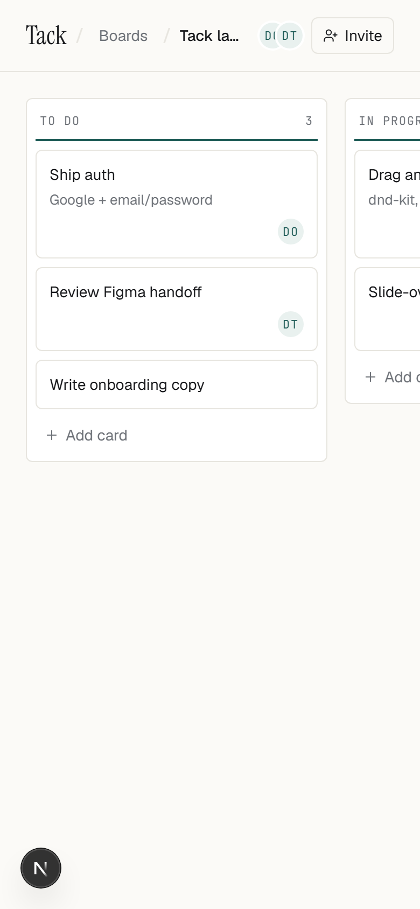

**A minimal team board. Lists, cards, drag, done.**

**[Live demo →](https://tack-sigma.vercel.app)**

---

## Overview

Tack is a small, opinionated project board — boards → lists → cards, dragged between lists with the mouse or keyboard. It's built to look deliberate with almost no UI: one accent color, hairline borders, a mono-label layer for structure, and a single signature detail — the "tack rail," a pine underline that fills a list header only when it holds cards.

## Screenshots

<table>
<tr>
<td width="50%"> Login — Google + credentials</td>
<td width="50%"> Boards grid</td>
</tr>
<tr>
<td width="50%"> Board — lists, cards, drag &amp; drop</td>
<td width="50%"> Board at 390px</td>
</tr>
</table>

## Highlights

- **Cinematic video hero** — fullscreen looping background video with a hand-rolled fade-in/fade-out crossfade (no hard loop cut), Instrument Serif + Inter type, gradient overlays, and staggered fade-rise entrance animations.
- **Boards, lists, cards** — inline creation, drag-and-drop across and within lists (`dnd-kit`), optimistic UI on every mutation.
- **Search & filter** — a board-level search box dims out cards that don't match on title or assignee, without disturbing drag-and-drop.
- **Due dates** — optional per-card due date, shown on the card and flagged red once it's overdue and still incomplete.
- **Completion tracking** — a checkbox marks a card done and records *when*, server-side, like a to-do list; the timestamp shows on the card panel.
- **Google + email/password auth**, sessions as JWT.
- **Card detail slide-over** — description, assignee, due date, completion, delete, autosaves on blur.
- **Live sync** — teammates' changes appear without a manual refresh.
- **Motion throughout** — page transitions, tap/hover feedback, animated panels — respecting `prefers-reduced-motion`, and deliberately kept off the draggable cards so it never fights `dnd-kit`'s own transform.
- **Clean, permanent URLs** — `/boards/{id}/{title-slug}`, renaming a board never breaks a shared link.
- **Fully responsive**, audited down to a 320px viewport.
- **Server Actions only** — no REST layer, no client-side data-fetching library.

## Tech stack

| Layer | Choice |
|---|---|
| Framework | Next.js 16, App Router, TypeScript (strict) |
| Styling | Tailwind CSS v4, custom design tokens |
| Typography | Instrument Serif (display) + Inter (body) |
| Motion | Framer Motion |
| Auth | Auth.js v5 — Google OAuth + Credentials |
| Database | Prisma + PostgreSQL (Neon) |
| Drag & drop | `@dnd-kit/core` + `@dnd-kit/sortable` |
| Deployment | Vercel |

## Design system — "bone & pine"

| Token | Value | Used for |
|---|---|---|
| `--color-bone` | `#FBFAF7` | App background |
| `--color-surface` | `#FFFFFF` | Cards, panels |
| `--color-ink` | `#17181B` | Primary text |
| `--color-muted` | `#6E7278` | Secondary text |
| `--color-rule` | `#E7E5DF` | Hairlines |
| `--color-pine` | `#1F5C57` | The one accent |
| `--color-tint` | `#E9F1EF` | Hover / active states |

One accent color, no gradients, no shadow at rest — the only shadow in the app is on a card mid-drag.

## Contributing

Contributions of every size are welcome, from fixing a typo to building a feature, and no experience is required. Issues labelled [**good first issue**](https://github.com/rohithprem18/tack/issues?q=is%3Aissue+is%3Aopen+label%3A%22good+first+issue%22) are picked to be a friendly start.

  
  
  
  

1. **Pick an issue** (or open one with your idea) and comment that you're working on it.
2. **Fork** the repository and create a branch: `git checkout -b fix/short-description`.
3. **Make your change** and run the same checks as CI (see [`.github/workflows/ci.yml`](.github/workflows/ci.yml)).
4. **Open a pull request.** When every check passes, it is **merged automatically** and you appear under [Contributors](#contributors).

Changes to workflows, dependencies or deployment config wait for a maintainer review. See the [contributing guide](https://github.com/rohithprem18/.github/blob/main/CONTRIBUTING.md) and the [Code of Conduct](https://github.com/rohithprem18/.github/blob/main/CODE_OF_CONDUCT.md).

## Contributors

Thanks to everyone who has helped build this project!

<!-- CONTRIBUTORS:START -->
<table>
  <tbody>
    <tr>
      <td align="center" valign="top" width="14%"><a href="https://github.com/rohithprem18"> <b>rohithprem18</b></a> 31 commits</td>
    </tr>
  </tbody>
</table>

1 contributor so far. This list updates automatically after every merged pull request.

<!-- CONTRIBUTORS:END -->

## License

Distributed under the MIT License. See [LICENSE](LICENSE) for details.
